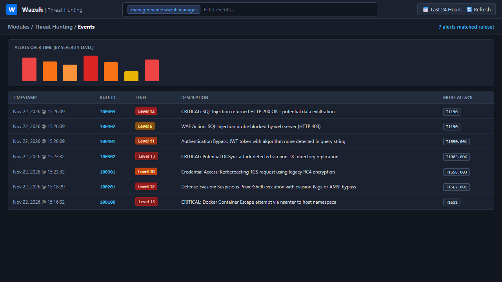

# BÁO CÁO ĐIỀU TRA SỰ CỐ: TẤN CÔNG THOÁT QUYỀN CONTAINER (DOCKER ESCAPE - T1611)

## 1. Thông Tin Sự Cố
- Mã sự cố: INC-202611-001
- Mức độ ưu tiên: P1 - Critical (Nguy cấp)
- Phân loại: True Positive (Tấn công thật)
- Trạng thái: Đã xử lý xong (Closed)
- Người xử lý: SOC Tier 1 Analyst
- Máy mục tiêu: Ubuntu 24.04 WSL2 Host (DESKTOP-O7NQ6VH)
- Bộ phát hiện: Wazuh Manager (Rule 100100 - Level 13)

## 2. Tóm Tắt Sự Cố (Mô Hình SBAR)
- **S (Tình huống):** Hệ thống SIEM nổ cảnh báo đỏ mức 13 phát hiện lệnh `nsenter --target 1` can thiệp không gian tiến trình máy chủ từ một container Docker.
- **B (Bối cảnh):** Container microservice được khởi chạy với 2 cờ nguy hiểm: `--privileged` (cấp toàn quyền thiết bị) và `--pid=host` (dùng chung danh sách tiến trình với máy chủ ngoài).
- **A (Đánh giá):** Đây là sự cố tấn công thật (True Positive). Kẻ tấn công sau khi chiếm quyền điều khiển container đã dùng lệnh `nsenter` để nhảy vào không gian của tiến trình PID 1 (`systemd/init` của máy chủ vật lý), thoát khỏi phòng giam Docker và chiếm quyền root máy chủ.
- **R (Khuyến nghị):** Lập tức dừng container vi phạm, xóa bỏ các cờ cấu hình đặc quyền, và kiểm tra tệp hệ thống trên máy chủ xem có bị cài cắm mã độc hay backdoor không.

## 3. Bằng Chứng Log & Phân Tích Kỹ Thuật

Dòng log trích xuất từ `shared-logs/linux_auth.log`:
```text
Nov  9 09:16:02 DESKTOP-O7NQ6VH sudo:   nam2945 : TTY=pts/0 ; PWD=/home/nam2945/My-SOC-Lab ; USER=root ; COMMAND=/usr/bin/docker run --rm --privileged --pid=host alpine nsenter --target 1 --mount --uts --ipc --net --pid -- /bin/sh
```

Các trường thông tin bóc tách:
- Thời gian: Nov 9 09:16:02
- Máy chủ: DESKTOP-O7NQ6VH
- Tiến trình ghi log: sudo
- Người thực thi: root (qua tài khoản nam2945)
- Câu lệnh: `/usr/bin/docker run --rm --privileged --pid=host alpine nsenter --target 1 --mount --uts --ipc --net --pid -- /bin/sh`
- Rule kích hoạt: 100100 (Level 13)

Phân tích chi tiết:
- Wazuh nhận diện log sudo qua Rule cha 5402 (`Successful sudo to ROOT executed`), bóc tách sẵn người thực thi và câu lệnh.
- Rule 100100 sử dụng biểu thức chính quy `nsenter\s+.*--target\s+1` để bắt chính xác hành vi can thiệp.
- Tham số `--target 1` nhắm thẳng vào tiến trình gốc PID 1 của máy chủ. Khi kết hợp với các cờ `--mount --uts --ipc --net --pid`, toàn bộ ranh giới cô lập (Linux Namespaces) bị dỡ bỏ, kẻ tấn công nhận được một shell tương tác trực tiếp với quyền root của máy chủ vật lý.



## 4. Dấu Hiệu Kỹ Thuật (Artifacts & Threat Intelligence)
- Tiện ích bị lạm dụng: `/usr/bin/nsenter` (Tiện ích chuẩn của Linux bị kẻ tấn công vũ khí hóa).
- Môi trường phát sinh: Docker Runtime trên Ubuntu 24.04 LTS.
- Phạm vi ảnh hưởng: Thực thi cục bộ trên máy chủ trạm, chưa phát hiện IP điều khiển từ xa (C2) trong pha này.
- Hai vector thoát container phổ biến khác cần kiểm tra:
  1. Mount nhầm file `/var/run/docker.sock` vào container (cho phép gọi Docker API để tạo container mới gắn `-v /:/host` rồi chạy `chroot`).
  2. Lạm dụng cờ `--privileged` để mount trực tiếp phân vùng ổ cứng vật lý `/dev/sda1` từ bên trong container.

## 5. Ánh Xạ MITRE ATT&CK
- Tactic: Privilege Escalation (Leo thang đặc quyền) / Defense Evasion (Né tránh phòng thủ)
- Technique ID: T1611 (Escape to Host)

## 6. Các Bước Xử Lý & Khắc Phục
- Cô lập: Dừng và xóa ngay lập tức container vi phạm bằng lệnh `docker stop` và `docker rm`.
- Làm sạch: Rà soát tệp `/etc/passwd`, `/etc/shadow`, khóa SSH trong `/root/.ssh/authorized_keys` và thư mục `/tmp` để xác nhận kẻ tấn công chưa tạo thêm tài khoản ẩn hay cắm backdoor.
- Phục hồi: Thiết lập lại cấu hình khởi chạy container theo nguyên tắc đặc quyền tối thiểu (bỏ cờ `--privileged` và `--pid=host`).

## 7. Đúc Kết & Tinh Chỉnh Luật (Rule Tuning)
- Quy tắc 100100 hoạt động chuẩn xác, không cần thêm cấu hình loại trừ (whitelist) vì trong môi trường thực tế không có bất kỳ container nghiệp vụ nào được phép dùng lệnh `nsenter` sang tiến trình PID 1 của máy chủ.
