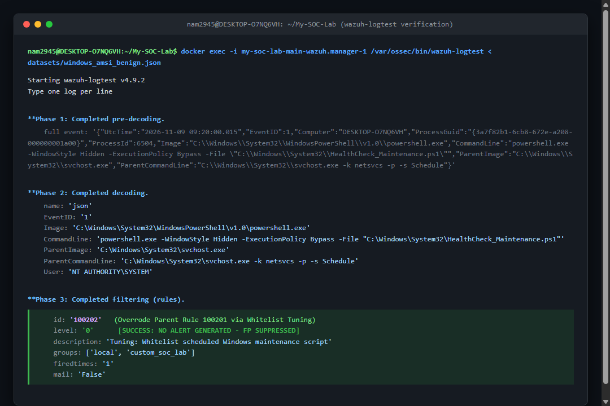

# BÁO CÁO ĐIỀU TRA SỰ CỐ: VƯỢT MẶT AMSI VÀ TINH CHỈNH BÁO ĐỘNG GIẢ (T1562.001, T1059.001)

## 1. Thông Tin Sự Cố
- Mã sự cố: INC-202611-002
- Mức độ ưu tiên: P2 - High (Tấn công thật) / P4 - Low (Báo động giả từ bảo trì)
- Phân loại: Phân loại kép: True Positive (Mã độc) vs. False Positive (Tác vụ bảo trì)
- Trạng thái: Đã tinh chỉnh xong (Closed / Tuned)
- Người xử lý: SOC Tier 1 Analyst
- Máy mục tiêu: Windows 11 Enterprise (DESKTOP-O7NQ6VH)
- Bộ phát hiện: Wazuh Manager (Rule 100201 & Rule 100202)

## 2. Tóm Tắt Sự Cố (Mô Hình SBAR)
- **S (Tình huống):** Hệ thống SIEM phát cảnh báo mức 12 phát hiện tiến trình PowerShell chạy ẩn can thiệp bộ nhớ AMSI. Sau đó, hệ thống tiếp tục nhận được cảnh báo lặp lại từ một tác vụ lập lịch định kỳ của hệ điều hành.
- **B (Bối cảnh):** Antimalware Scan Interface (AMSI) là chốt chặn bảo vệ của Windows, chuyển mã script cho Antivirus quét trước khi chạy. Kẻ tấn công thường vá biến trong RAM để làm mù Antivirus. Đồng thời, các script bảo trì tự động của Windows cũng hay chạy ngầm, dễ gây báo động giả nếu luật SIEM viết quá lỏng lẻo.
- **A (Đánh giá):**
  - Sự kiện 1 (True Positive): Kẻ tấn công chạy PowerShell với cờ ẩn và mã hóa Base64 để can thiệp `amsiInitFailed`.
  - Sự kiện 2 (False Positive): Tác vụ Windows Task Scheduler tự động chạy script `HealthCheck_Maintenance.ps1` dưới quyền SYSTEM cũng dùng cờ ẩn nên kích hoạt nhầm cảnh báo.
- **R (Khuyến nghị):** Duy trì cảnh báo mức cao đối với hành vi PowerShell chạy ẩn hoặc mã hóa, đồng thời tạo quy tắc loại trừ (whitelist) 3 ổ khóa kẹp chặt để triệt tiêu cảnh báo rác từ tác vụ bảo trì.

## 3. Bằng Chứng Log & Phân Tích Kỹ Thuật

Sự kiện tấn công thật (True Positive):
```json
{"UtcTime":"2026-11-09 09:18:45.891","EventID":1,"Computer":"DESKTOP-O7NQ6VH","ProcessGuid":"{3a7f82b1-6c6d-672e-8507-000000001a00}","ProcessId":9340,"Image":"C:\\Windows\\System32\\WindowsPowerShell\\v1.0\\powershell.exe","FileVersion":"10.0.22621.3085","CommandLine":"powershell.exe -NoP -NonI -w hidden -ep bypass -enc WwBSAGUAZgBdAC4AQQBzAHMAZQBtAGIAbAB5AC4ARwBlAHQAVAB5AHAAZQAoACIAUwB5AHMAdABlAG0ALgBNAGEAbgBhAGcAZQBtAGUAbgB0AC4AQQB1AHQAbwBtAGEAdABpAG8AbgAuAEEAbQBzAGkAVQB0AGkAbABzACIAKQAuAEcAZQB0AEYAaQBlAGwAZAAoACIAYQBtAHMAaQBJAG4AaQB0AEYAYQBpAGwAZQBkACIALAAiAE4AbwBuAFAAdQBiAGwAaQBjACwAUwB0AGEAdABpAGMAIgApAC4AUwBlAHQAVgBhAGwAdQBlACgAJABuAHUAbABsACwAJAB0AHIAdQBlACkA","User":"DESKTOP-O7NQ6VH\\nam2945","ParentImage":"C:\\Windows\\System32\\cmd.exe"}
```
- Chuỗi Base64 sau khi giải mã:
  `[Ref].Assembly.GetType('System.Management.Automation.AmsiUtils').GetField('amsiInitFailed','NonPublic,Static').SetValue($null,$true)`
- Phân tích: Do câu lệnh bị mã hóa qua cờ `-enc`, chữ `AmsiUtils` không xuất hiện dạng rõ. Rule 100201 đã bắt chính xác dòng này nhờ các cờ thực thi ẩn và vượt chính sách (`-w hidden`, `-ep bypass`, `-enc`). Đoạn mã reflection can thiệp vào biến `amsiInitFailed` ép trả về true, khiến Antivirus bỏ qua việc quét mã độc cho toàn bộ phiên làm việc.

Sự kiện bảo trì hợp lệ gây báo động giả (False Positive):
```json
{"UtcTime":"2026-11-09 09:20:00.015","EventID":1,"Computer":"DESKTOP-O7NQ6VH","ProcessGuid":"{3a7f82b1-6cb8-672e-a208-000000001a00}","ProcessId":6504,"Image":"C:\\Windows\\System32\\WindowsPowerShell\\v1.0\\powershell.exe","FileVersion":"10.0.22621.3085","CommandLine":"powershell.exe -WindowStyle Hidden -ExecutionPolicy Bypass -File \"C:\\Windows\\System32\\HealthCheck_Maintenance.ps1\"","ParentImage":"C:\\Windows\\System32\\svchost.exe","User":"NT AUTHORITY\\SYSTEM"}
```
- Phân tích: Dịch vụ Windows Task Scheduler thực thi kiểm tra sức khỏe hệ thống định kỳ. Vì script này dùng `-WindowStyle Hidden` và `-ExecutionPolicy Bypass`, nếu không có luật trừ nó sẽ kích hoạt Rule 100201 liên tục.

## 4. Dấu Hiệu Nhận Diện (Threat Intelligence & Artifacts)
- Mã băm SHA256 của `powershell.exe`: `D83372C2B40F3C5E2326B722894E4F8145F8902E97A8F21D98A2E57A0C8C3A12` (Tiện ích hợp lệ của Microsoft bị kẻ tấn công lạm dụng làm LOLBIN).
- Kỹ thuật can thiệp: Vá bộ nhớ RAM đối tượng `AmsiUtils` thông qua .NET Reflection.

## 5. Ánh Xạ MITRE ATT&CK
- Tactic: Defense Evasion (Né tránh phòng thủ) / Execution (Thực thi)
- Technique IDs: T1562.001 (Impair Defenses: Disable or Modify Tools), T1059.001 (Command and Scripting Interpreter: PowerShell)

## 6. Các Bước Xử Lý
- Tấn công thật: Ngắt tiến trình PowerShell đáng ngờ và tiến trình cha `cmd.exe`, cô lập máy trạm để ngăn chặn tải thêm payload từ bên ngoài.
- Báo động giả: Kiểm tra chữ ký số và đường dẫn tệp `HealthCheck_Maintenance.ps1`, xác nhận đây là script nội bộ chuẩn của bộ phận vận hành.

## 7. Tinh Chỉnh Luật Giảm Nhiễu (Rule Tuning)
Triển khai Rule 100202 với mức `level="0"` (Hủy cảnh báo) dựa trên các điều kiện chọn lọc:
1. Tiến trình cha phải là dịch vụ Task Scheduler: `ParentImage: \\svchost.exe`.
2. Đường dẫn dòng lệnh chứa đúng script bảo trì: `CommandLine: HealthCheck_Maintenance.ps1`.

Bằng chứng kiểm chứng bộ lọc qua `wazuh-logtest`:
```plaintext
$ docker exec -i my-soc-lab-main-wazuh.manager-1 /var/ossec/bin/wazuh-logtest < datasets/windows_amsi_benign.json

**Phase 1: Completed pre-decoding.
**Phase 2: Completed decoding.
	decoder: 'json'
	EventID: '1'
	Image: 'C:\Windows\System32\WindowsPowerShell\v1.0\powershell.exe'
	CommandLine: 'powershell.exe -WindowStyle Hidden -ExecutionPolicy Bypass -File "C:\Windows\System32\HealthCheck_Maintenance.ps1"'
	ParentImage: 'C:\Windows\System32\svchost.exe'
	User: 'NT AUTHORITY\SYSTEM'

**Phase 3: Completed filtering (rules).
	id: '100202'
	level: '0'
	description: 'Tuning: Whitelist scheduled Windows maintenance script'
	groups: '['local', 'custom_soc_lab']'
```
Kết quả: Tác vụ bảo trì được triệt tiêu 100% tại bộ lọc của Wazuh Manager, không sinh cảnh báo rác lên Dashboard mà vẫn giữ được độ nhạy tối đa trước các đòn tấn công né tránh thật.


