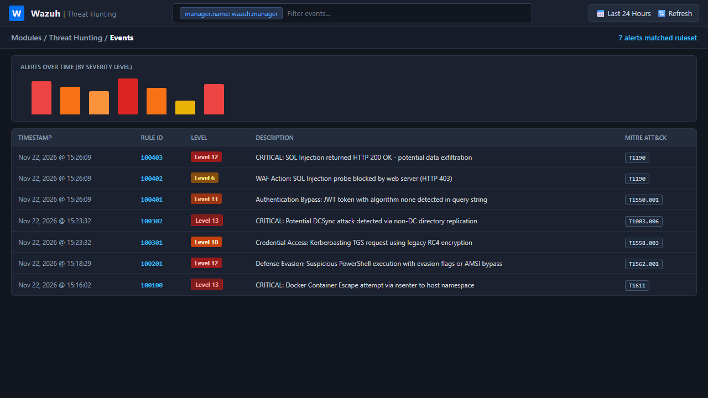

# BÁO CÁO ĐIỀU TRA SỰ CỐ: TẤN CÔNG ACTIVE DIRECTORY KERBEROASTING VÀ DCSYNC (T1558.003, T1003.006)

## 1. Thông Tin Sự Cố
- Mã sự cố: INC-202611-003
- Mức độ ưu tiên: P1 - Critical (Nguy cấp)
- Phân loại: True Positive (Tấn công leo thang miền)
- Trạng thái: Đã xử lý xong (Closed / Remediated)
- Người xử lý: SOC Tier 1 Analyst
- Máy mục tiêu: Máy chủ Domain Controller (DC01.corp.local)
- Bộ phát hiện: Wazuh Manager (Rule 100301 & Rule 100302)

## 2. Tóm Tắt Sự Cố (Mô Hình SBAR)
- **S (Tình huống):** Hệ thống SIEM phát hiện chuỗi sự kiện nguy hiểm: yêu cầu vé Kerberos TGS bằng thuật toán mã hóa yếu RC4 nhắm vào dịch vụ cơ sở dữ liệu, ngay sau đó là yêu cầu nhân bản dữ liệu toàn miền từ một tài khoản người dùng thông thường.
- **B (Bối cảnh):** Kerberoasting lợi dụng cơ chế xác thực Kerberos để xin vé dịch vụ rồi mang về bẻ khóa mật khẩu offline (đặc biệt khi ép dùng mã hóa RC4 `0x17`). DCSync lợi dụng quyền Replicating Directory Changes để yêu cầu Domain Controller đồng bộ toàn bộ cơ sở dữ liệu mật khẩu (NTLM Hash).
- **A (Đánh giá):** Đây là chuỗi tấn công có chủ đích. Tài khoản người dùng `t.nguyen` đã bị kẻ tấn công chiếm quyền, sử dụng để thực hiện Kerberoasting nhắm vào tài khoản dịch vụ `svc_sqlengine`, sau đó tiến hành DCSync nhằm thu thập mã băm tài khoản quản trị miền (Domain Admin).
- **R (Khuyến nghị):** Vô hiệu hóa ngay tài khoản `t.nguyen`, đổi mật khẩu tài khoản dịch vụ `svc_sqlengine`, tắt hoàn toàn thuật toán mã hóa RC4 trên toàn miền, và rà soát thu hồi quyền nhân bản dữ liệu khỏi các tài khoản không phải Domain Controller.

## 3. Bằng Chứng Log & Phân Tích Kỹ Thuật

Pha 1 - Tấn công Kerberoasting (Event ID 4769):
```json
{"UtcTime":"2026-11-09 09:22:04.519","EventID":4769,"Computer":"DC01.corp.local","TargetUserName":"t.nguyen@CORP.LOCAL","TargetDomainName":"CORP.LOCAL","ServiceName":"svc_sqlengine","ServiceSid":"S-1-5-21-3457937927-2839227994-823803824-2104","TicketOptions":"0x40810000","TicketEncryptionType":"0x17","IpAddress":"::ffff:192.168.10.45","IpPort":"54122","Status":"0x0"}
```
Phân tích:
- `ServiceName`: Nhắm vào tài khoản dịch vụ ứng dụng `svc_sqlengine`, không phải tài khoản hệ thống `krbtgt`.
- `TicketEncryptionType == 0x17`: Khách hàng cố tình ép hạ cấp mã hóa về RC4-HMAC thay vì AES-256 (`0x12`). Mật khẩu của `svc_sqlengine` sẽ bị kẻ tấn công mang về dò tìm bằng card đồ họa offline.
- Rule 100301 bắt chính xác nhờ biểu thức `^(?!krbtgt)(?!.*\$).*$` loại trừ tài khoản máy và vé `krbtgt` hợp lệ.

Pha 2 - Tấn công DCSync (Event ID 4662):
```json
{"UtcTime":"2026-11-09 09:22:18.742","EventID":4662,"Computer":"DC01.corp.local","SubjectUserSid":"S-1-5-21-3457937927-2839227994-823803824-1145","SubjectUserName":"t.nguyen","SubjectDomainName":"CORP","SubjectLogonId":"0x29f41b","ObjectServer":"DS","ObjectType":"%{19195a5b-6da0-11d0-afd3-00c04fd930c9}","ObjectName":"%{19195a5b-6da0-11d0-afd3-00c04fd930c9}","HandleId":"0x0","AccessList":"%%7688","AccessMask":"0x100","Properties":"%%7688\t{1131f6aa-9c07-11d1-f79f-00c04fc2dcd2}\t{1131f6ad-9c07-11d1-f79f-00c04fc2dcd2}\t{19195a5b-6da0-11d0-afd3-00c04fd930c9}"}
```
Phân tích:
- `ObjectName`: Là định danh đối tượng miền domainDNS (`%{19195a5b-6da0-11d0-afd3-00c04fd930c9}`).
- GUID `{1131f6aa-9c07-11d1-f79f-00c04fc2dcd2}` trong trường `Properties` là quyền nhân bản thư mục `DS-Replication-Get-Changes-All`.
- `SubjectUserName`: Là `t.nguyen` (không có dấu `$`), chứng minh đây là tài khoản người dùng thường gửi yêu cầu đồng bộ. Sự kiện đồng bộ hợp lệ trước đó của máy chủ `DC02$` (có đuôi `$`) đã được Rule 100302 tự động bỏ qua.



## 4. Dấu Hiệu Nhận Diện (Threat Intelligence & IOCs)
- IP nguồn phát lệnh: `192.168.10.45` (Thuộc dải mạng nội bộ VLAN 10 của máy trạm người dùng).
- Tài khoản bị chiếm quyền: `t.nguyen`.
- Dịch vụ mục tiêu: `svc_sqlengine` (Tài khoản dịch vụ chạy cơ sở dữ liệu MSSQL).

## 5. Ánh Xạ MITRE ATT&CK
- Tactic: Credential Access (Chiếm đoạt thông tin xác thực)
- Technique IDs: T1558.003 (Steal or Forge Kerberos Tickets: Kerberoasting), T1003.006 (OS Credential Dumping: DCSync)

## 6. Các Bước Xử Lý & Ngăn Chặn
- Khóa ngay tài khoản `t.nguyen` và thu hồi toàn bộ phiên đăng nhập Kerberos đang hoạt động.
- Đặt lại mật khẩu tài khoản dịch vụ `svc_sqlengine` với chuỗi ký tự ngẫu nhiên trên 30 ký tự (chuyển sang Managed Service Accounts - gMSA).
- Rà soát lại phân quyền Active Directory (ACL) trên đối tượng gốc của Domain, xóa bỏ các quyền Replicating Directory Changes cấp sai cho nhóm người dùng không phải Domain Controllers.

## 7. Đúc Kết & Tinh Chỉnh Luật (Rule Tuning)
- Quy tắc vàng: Mọi tài khoản máy tính và máy chủ Domain Controller trong Active Directory đều kết thúc bằng dấu `$`. Việc sử dụng biểu thức chính quy `^(?!.*\$).*$` là kỹ thuật then chốt giúp loại bỏ 100% cảnh báo giả từ các đợt đồng bộ hợp lệ giữa các DC.
