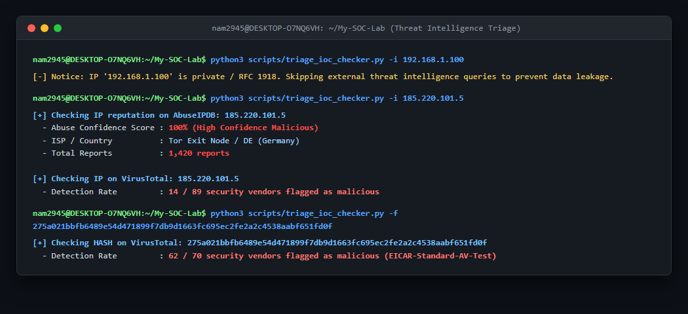

# BÁO CÁO ĐIỀU TRA SỰ CỐ: TẤN CÔNG JWT NONE VÀ PHÂN LOẠI RỦI RO SQL INJECTION (T1550.001, T1190)

## 1. Thông Tin Sự Cố
- Mã sự cố: INC-202611-004
- Mức độ ưu tiên: P1 - Critical (SQLi thành công) / P2 - High (Mạo danh JWT)
- Phân loại: True Positive (Tấn công ứng dụng Web API)
- Trạng thái: Đã xử lý xong (Closed / Remediated)
- Người xử lý: SOC Tier 1 Analyst
- Máy mục tiêu: Cổng API Web Nginx (Production Gateway)
- Bộ phát hiện: Wazuh Manager (Rule 100401, Rule 100402, Rule 100403)

## 2. Tóm Tắt Sự Cố (Mô Hình SBAR)
- **S (Tình huống):** Log truy cập Web ghi nhận liên tiếp 3 đợt tấn công từ IP `185.220.101.5`: sử dụng token JWT không chữ ký (`alg:none`), gửi đầu dò SQL Injection bị chặn (mã 403), và thực hiện câu lệnh SQLi khai thác thành công (mã 200).
- **B (Bối cảnh):** Lỗ hổng kinh điển CVE-2015-9235 trong cơ chế xử lý JWT cho phép chấp nhận thuật toán `"alg": "none"` để lách qua bước kiểm tra chữ ký số (Signature). Đồng thời, tham số tìm kiếm sản phẩm trên API chưa được lọc đầu vào, tạo điều kiện cho kẻ tấn công chèn lệnh SQL đọc cơ sở dữ liệu.
- **A (Đánh giá):**
  - Đợt 1: Kẻ tấn công giả mạo token admin bằng chuỗi `alg:none`.
  - Đợt 2: Dùng sqlmap thăm dò endpoint `/api/v1/blocked/search` bị WAF chặn với mã HTTP 403 Forbidden (rủi ro thấp).
  - Đợt 3: Chuyển hướng sang endpoint `/api/v1/products` với payload `UNION SELECT username,password_hash FROM users--` thành công, máy chủ trả về mã HTTP 200 OK với lượng dữ liệu vọt lên 8450 bytes (rò rỉ dữ liệu tài khoản nghiêm trọng).
- **R (Khuyến nghị):** Chặn đứng IP `185.220.101.5` trên tường lửa/WAF, cấu hình API backend từ chối tuyệt đối token có `alg:none`, và chuyển câu truy vấn SQL sang dạng tham số hóa (Parameterized Queries / ORM).

## 3. Bằng Chứng Log & Phân Tích Kỹ Thuật

Sự kiện 1 - Tấn công JWT Algorithm None (Rule 100401 - Level 11):
```text
185.220.101.5 - - [09/Nov/2026:09:25:15 +0700] "GET /api/v1/user/profile?access_token=eyJhbGciOiJub25lIiwidHlwIjoiSldUIn0.eyJ1c2VyIjoiYWRtaW4iLCJyb2xlIjoiYWRtaW4ifQ. HTTP/1.1" 200 418 "-" "python-requests/2.31.0"
```
- Chuỗi Base64 Header giải mã: `{"alg":"none","typ":"JWT"}` (luôn có tiền tố cố định `eyJhbGciOiJub25l...`).
- Chuỗi Base64 Payload giải mã: `{"user":"admin","role":"admin"}`. Kẻ tấn công xóa bỏ phần chữ ký số thứ ba để ép máy chủ nhận diện quyền admin.

Sự kiện 2 - Đầu dò SQL Injection bị chặn (Rule 100402 - Level 6):
```text
185.220.101.5 - - [09/Nov/2026:09:25:19 +0700] "GET /api/v1/products?cat=books%27%20OR%201=1-- HTTP/1.1" 403 162 "-" "sqlmap/1.8.4#stable (https://sqlmap.org)"
```
- Phân tích: Tường lửa WAF phát hiện chuỗi payload `books' OR 1=1--` và chặn đứng với mã HTTP 403 Forbidden, dung lượng phản hồi chỉ 162 bytes. Đây là sự kiện thăm dò bị chặn, gán Level 6 để theo dõi mà không làm gián đoạn SOC.

Sự kiện 3 - SQL Injection khai thác thành công (Rule 100403 - Level 12):
```text
185.220.101.5 - - [09/Nov/2026:09:25:24 +0700] "GET /api/v1/products?cat=books%27%20UNION%20SELECT%20username,password_hash%20FROM%20users-- HTTP/1.1" 200 8450 "-" "Mozilla/5.0 (X11; Linux x86_64; rv:109.0) Gecko/20100101 Firefox/119.0"
```
- Phân tích: Máy chủ trả về mã HTTP 200 OK và **kích thước phản hồi vọt lên tới 8450 bytes** (so với mức 418 bytes bình thường). Sự đột biến bất thường về dung lượng phản hồi kết hợp mã 200 là bằng chứng thép chứng minh bảng tài khoản người dùng đã bị kết xuất trọn vẹn ra ngoài.

## 4. Tra Cứu Dấu Hiệu (SOC Triage & Threat Intelligence)
- IP nguồn tấn công: `185.220.101.5` (Tra cứu qua công cụ `triage_ioc_checker.py` xác nhận là Tor Exit Node / IP quét công cộng).
- Nguyên tắc chống rò rỉ dữ liệu (RFC 1918 Guard): Các IP nội bộ xuất hiện trong log như `192.168.1.25` và `192.168.1.40` được script tự động bỏ qua, không gửi lên VirusTotal hay AbuseIPDB để bảo vệ bí mật sơ đồ mạng doanh nghiệp.


- Công cụ sử dụng: `sqlmap/1.8.4` và trình duyệt giả lập trên Linux.
- Chữ ký nhận diện: Chuỗi token `eyJhbGciOiJub25l` trên URI và payload `UNION SELECT`.

## 5. Ánh Xạ MITRE ATT&CK
- Tactic: Defense Evasion (Né tránh) / Initial Access (Thâm nhập ban đầu)
- Technique IDs: T1550.001 (Application Access Token), T1190 (Exploit Public-Facing Application)

## 6. Các Bước Xử Lý & Khắc Phục
- WAF: Bổ sung luật ModSecurity chặn đứng tất cả request chứa chuỗi `eyJhbGciOiJub25l` hoặc các từ khóa SQLi trên query string.
- Ứng dụng Backend: Viết lại các hàm truy vấn cơ sở dữ liệu trên endpoint `/api/v1/products` bằng Prepared Statements (Pydantic / ORM), tuyệt đối không nối chuỗi thô.
- Tài khoản: Thu hồi toàn bộ phiên đăng nhập của người dùng và đổi mật khẩu quản trị.

## 7. Đúc Kết & Tinh Chỉnh Phân Loại (Triage Lessons)
- Việc phân tách rõ ràng giữa HTTP 403 (Level 6) và HTTP 200 (Level 12) cùng việc quan sát cột kích thước phản hồi (Response Bytes) giúp SOC Tier 1 nhận diện ngay tức khắc sự cố rò rỉ dữ liệu thực tế thay vì mất thời gian vào các đợt quét tự động vô hại trên Internet.
